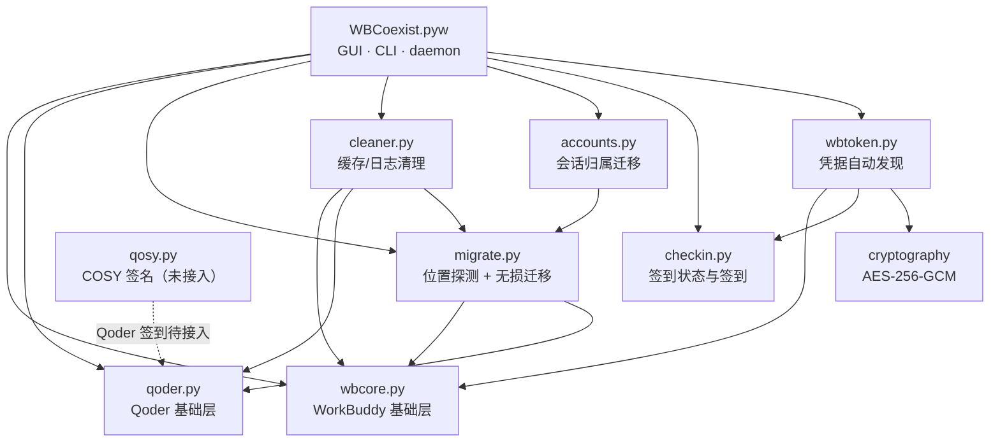

# CODEGRAPH · 代码图谱

> 面向人与 AI 的模块依赖、数据流与入口索引。基于 2026-11-13 对本仓库的 AST 解析和本机实测生成，只记录**已落地**的代码；用户文档见 [README.md](README.md)，版本记录见 [CHANGELOG.md](CHANGELOG.md)。

## 1. 架构一句话

单进程 Tkinter GUI 编排 + 若干纯逻辑模块。**所有外部副作用**（注册表读写、文件移动/联接、HTTP 签到、子进程）都收敛在 `wbcore` / `qoder` / `migrate` / `cleaner` / `wbtoken` 五个模块；GUI 只负责体检展示、按钮编排、后台线程与进度反馈。

分层（自下而上）：

| 层 | 模块 | 边界 |
|:---|:---|:---|
| 基础层 | `wbcore.py`、`qoder.py` | 不 import 任何本地模块；直接与注册表/文件系统/进程表交互 |
| 发现层 | `migrate.py`、`wbtoken.py`、`checkin.py` | 依赖基础层，负责"位置/凭据/签到状态"的实测发现 |
| 业务层 | `cleaner.py`、`accounts.py`、`qosy.py` | 组合发现层结果，产出可勾选清单 / 迁移计划 / 签名会话 |
| 入口层 | `WBCoexist.pyw` | GUI、CLI、守护三种模式，唯一起点 |

## 2. 模块依赖图（AST 实测）



依赖方向是单向的：**基础层不反向依赖业务层或 GUI**。这是新增功能时唯一必须守住的约束。

## 3. 模块清单

| 文件 | 行数 | 职责 | 本地依赖 | 外部依赖 |
|:---|---:|:---|:---|:---|
| `WBCoexist.pyw` | 1283 | GUI（`gui_main`）、CLI（`main`）、守护（`daemon_main`）、自检（`selftest`）、安装监控（`_watch_installs`） | 全部业务模块 | `tkinter`、`threading`、`queue` |
| `wbcore.py` | 443 | WorkBuddy 安装发现、协议归属、缓存归档、配置、无窗口子进程 `run_hidden/no_window`、Toolhelp 进程枚举 | — | `winreg`、`ctypes` |
| `qoder.py` | 612 | Qoder 双版检测、connector 代际选择、manifest/注册修复、孤儿归档、签到前置检查、已安装枚举 | — | `winreg` |
| `migrate.py` | 344 | 位置探测（注册表 / product.json / 特征文件 / 会话 cwd）、迁移计划、零删除执行 | `wbcore`、`qoder` | `shutil`、`subprocess` |
| `cleaner.py` | 173 | 白名单缓存/日志扫描、逐项大小与说明、运行中禁用、只清目录内容 | `migrate`、`qoder`、`wbcore` | — |
| `accounts.py` | 172 | `workbuddy.db` 定位、账号会话统计、`sessions.user_id` 归属迁移（备份 + 事务） | `migrate` | `sqlite3` |
| `checkin.py` | 92 | 签到状态查询与签到（多域名 `base` 参数）、结果描述 | — | `urllib.request` |
| `wbtoken.py` | 161 | WorkBuddy 运行时取 `atRestSecretKey`、AES-256-GCM 解 `$wbEncrypted` 信封、token 自动发现 | `wbcore`、`checkin` | `cryptography` |
| `qosy.py` | 262 | Qoder COSY 签名链路：自定义 base64、纯 Python AES-128-CBC、RSA PKCS#1 v1.5、md5 签名、machine identity、Bearer/headers | — | 无（纯 Python） |
| `tools/verify_build.py` | 52 | CI 产物静态校验（版本资源 / manifest / UPX / SHA-256） | — | `pefile` |
| `tools/extract_changelog.py` | 37 | 按 tag 从 CHANGELOG 提取 Release 正文 | — | — |

## 4. 入口与运行模式

| 入口 | 触发 | 行为 |
|:---|:---|:---|
| `WBCoexist.exe` / `双版共存管家.lnk` | 双击 | `gui_main()`：启动即体检，8 盏灯 + 功能卡片 |
| `WBCoexist.bat` | 脚本调用备用 | 同上（双击会短暂闪 cmd 窗口） |
| `--daemon` | HKCU Run 开机自启 | `daemon_main()`：8 秒轮询，只修共享指向 |
| `--selftest` / `--smoke` | 自检 | 体检 + 修复预览 / 构建 GUI 后自动退出 |
| `--qoder-check/fix/clean` | CLI | `qoder_cli()`：Qoder 诊断与修复 |
| `--accounts` / `--move-sessions` | CLI | `accounts_cli()`：账号列表 / 会话归属迁移 |
| `--checkin-status` / `--checkin` | CLI | `checkin_cli()`：自动发现全部账号并查状态 / 签到 |
| `.github/workflows/build-release.yml` | 推 `v*` 标签 | checkout → 语法检查 → 4 组单测 → onefile + onedir → 校验 → 从 CHANGELOG 取 note → 发布 Release |

## 5. 关键数据流

### 5.1 体检与一键修复
```
gui_main.refresh() → wbcore.check() + qoder.check() → 8 盏灯
on_fix()          → wbcore.fix(apply=True) + qoder.fix(apply=True) → 自动复检
```
`wbcore.check()`：注册表卸载项 → 安装目录 → 数据目录特征 → 协议归属与缓存状态。
`qoder.check()`：`detect_intl/detect_cn` → `_pick_target()` 按版本号选 host 代际 → manifest / 浏览器注册核对。

### 5.2 自动签到（1.6.0，端到端已验证）
```
wbtoken.fetch_tokens()
  ├─ wbcore.installed()                     实测 WorkBuddy exe（注册表）
  ├─ ELECTRON_RUN_AS_NODE=1 + "-e" 内联 JS  → electron_browser_workbuddy_storage 绑定
  │    → atRestSecretKey → sha256 → 32 字节 AES-256-GCM key
  └─ 解 %APPDATA%/WorkDaddy/accounts/<uid>.info 的 $wbEncrypted 信封
       （WBEV1 帧 + WB-AAD 域 + suite/keyId 绑定）→ JWT + auth.domain
→ checkin.status(token, uid, base=domain)
       POST {domain}/v2/billing/meter/checkin-activity-status（失败回退 checkin-status）
→ 未签到则 checkin.do_checkin()：POST .../daily-checkin
```
两个账号可分别落在 `www.workbuddy.cn` / `www.codebuddy.cn`，`base` 由备份里的 `auth.domain` 决定，不是常量。

### 5.3 无损迁移
```
migrate.scan()  → plan(keys, target) → precheck() → migrate_one(apply=True)
  robocopy /E /XJ → 校验文件数 → os.rename(src, src.bak)
  → mklink /J src dst → 写探针文件验证 → 任一步失败自动回滚
```
原目录改名 `.bak` 保留，**不删任何文件**；目标目录校验必填、盘存在、不与源同盘、不互相包含、可写性探针。全部子进程经 `wbcore.run_hidden()`。

### 5.4 清理垃圾（1.6.0）
```
cleaner.scan(qr) → [{group,label,note,path,size,running}]
  ├─ WB_SPEC / WB_LOCAL / QODER_SPEC / QODER_PART 白名单
  ├─ migrate.scan() 提供自定义安装位置
  └─ Qoder 数据目录由安装目录 product.json 的 dataDirectoryName 推导
→ GUI 勾选清单（大小 + 内容说明，运行中的项灰显）
→ clean(items) → purge(p) 只删目录内容、保留目录
```
配置、会话、数据库、登录态（`Local Storage` / `IndexedDB` / `Network`）一律不碰；Qoder 旧代际 host 与失效中继记录归档到 `qoder-backups`，不删除。

### 5.5 位置探测（贯穿全项目，不硬编码）

| 目标 | 证据来源 |
|:---|:---|
| 软件本体 | 注册表 `Uninstall` 卸载项；Qoder 另扫 `<安装根>/.qoder-versions/*` |
| Qoder 数据目录 | 安装目录 `resources/product.json` 的 `dataDirectoryName` |
| WorkBuddy 数据目录 | 目录特征 `projects/` + `MEMORY.md` |
| 项目/工作区路径 | 会话 `*.jsonl` 首行的 `cwd` 字段（**不反解目录名**，目录名含 `-` 会有歧义） |
| 是否已迁移 | `os.lstat()` 的 reparse point 标志 + `os.readlink()` |
| 进程占用 | Win32 Toolhelp 快照（`wbcore.process_names`，不启动 `tasklist`） |

### 5.6 跨账号会话归属迁移
`accounts.find_db()` 定位 `workbuddy.db`（校验 `sessions` 表）→ `preview_move()` → `move(apply=True)`：先备份 DB → `BEGIN IMMEDIATE` → `UPDATE sessions SET user_id = ?` → 校验。会话文件按工作区存放、不含账号字段，因此**不搬文件**。

### 5.7 安装完成自动修复
`_watch_installs()` 比对各 exe 的 mtime 快照（存 `config.state`），检测到安装器替换程序后触发一次全量 `fix()`；守护循环 8 秒一轮。

## 6. 副作用与红线（改动时必须守住）

| 约束 | 实现位置 |
|:---|:---|
| 注册表只写 HKCU | `wbcore.fix` / `qoder.fix` / `autostart_set` |
| 零删除（除用户勾选的缓存清理） | 归档到 `.updater-archive` / `qoder-backups` / `.bak` |
| 子进程无控制台窗口 | `wbcore.no_window()` + `run_hidden()`（`CREATE_NO_WINDOW` + `SW_HIDE`） |
| 凭据不落盘、不进日志 | `wbtoken._KEY_JS_CODE` 只经子进程 stdout 管道回传 key |
| 网络仅用于签到 | `checkin._post()`，端点由 token 所属 domain 决定 |
| 耗时操作不卡 UI | `WBCoexist.pyw` 的 `task()` + 后台线程 + 按钮三态 |
| 基础层不反向依赖 GUI | 见第 2 节依赖图 |

`config.json` 键：`primary`、`guard`、`autostart`、`paths`、`archive_dir`、`checkin`、`state`。

## 7. 测试矩阵

| 文件 | 覆盖 | CI |
|:---|:---|:---|
| `tests/test_pick_target.py` | Qoder host 代际选择（版本高低 / 并列 / 缺版本 / 运行中优先） | ✓ |
| `tests/test_install_watch.py` | 安装检测 mtime 快照与冷启动不误报 | ✓ |
| `tests/test_installed.py` | 已安装枚举、路径规范化去重 | ✓ |
| `tests/test_migrate.py` | 目标根目录、纯逻辑探测、计划粒度 | ✓ |
| `tests/test_checkin.py` | 签到端点常量、配置解析、结果描述 | ✓ |
| `tests/test_cleaner.py` | 白名单、每项带说明、清空保留目录、运行中跳过、product.json 推导 | ✓ |

CI 现跑 6 组测试并做 `py_compile` 语法检查；`tools/verify_build.py` 在产物层校验 PE 版本资源、manifest、无 UPX 与 SHA-256。

## 8. 构建与发布

- 打包：PyInstaller 6.22.3 `--noconsole --onefile`（另有 onedir 便携版），`--noupx`，嵌入 `version_info.txt` + `app.manifest`。所有业务模块需 `--hidden-import`；`wbtoken` 依赖 `cryptography`（AES-GCM），打包时必须显式带上。
- `--specpath .` 是硬要求：PyInstaller 按 spec 所在目录解析 `--icon` / `--version-file` / `--manifest`，放子目录会 `FileNotFoundError`。
- CI：`windows-latest` + Python 3.10，推 `v*` 标签触发；Release 正文由 `tools/extract_changelog.py` 从 `CHANGELOG.md` 取对应版本段落。
- 发版由维护者手动打 `v*` 标签触发；日常改动直接提交到 `master`。

## 9. 已知未接入

| 项 | 状态 |
|:---|:---|
| `qosy.py`（Qoder COSY 签名） | 密码学链路已复刻且**全部官方向量通过**（base64 变体 / AES-128-CBC / RSA PKCS#1 v1.5 / 五行 md5 / machine identity / 16 项 headers），但**尚未接入运行时**：GUI 未 import，campaigns/claim 活动 API 与凭据管理器读取未完成 |
| Qoder 自动签到 | 上游活动平台 `GET /sash/api/v1/me/campaigns` + `POST …/{id}/claim`；国际版无该接口 |
| WorkBuddy 国际版签到 | 上游端点不存在，仅国内版支持 |
| 迁移路径参数化 | 已由 `migrate.scan()` 实测发现取代硬编码，Roadmap 里的旧条目已过时 |
