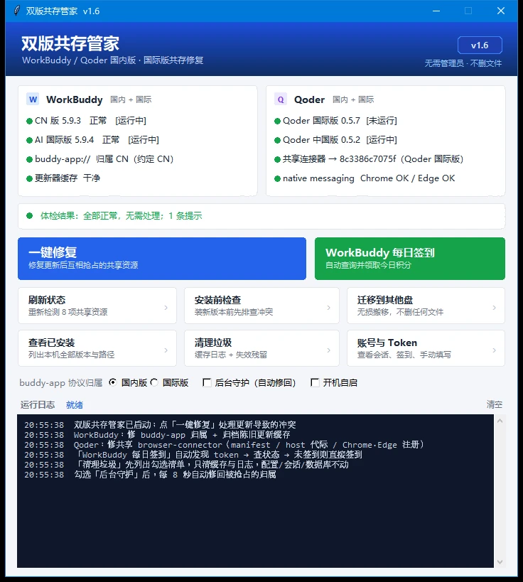

# 双版共存管家

**让同一款软件的国内版与国际版在同一台电脑上和平共处 —— 更新后不再互相抢资源。**




> 8 盏状态灯全绿：WorkBuddy 侧 4 盏（两个发行版的安装完整性、`buddy-app://` 归属、更新器缓存），
> Qoder 侧 4 盏（两版版本与运行状态、连接器 host 代际、Chrome / Edge 注册）。
> 图中那条提示是 Qoder 两版版本号不同（0.5.7 / 0.5.2），属信息提示而非故障。

## 目录

- [它解决什么](#它解决什么)
- [快速开始](#快速开始3-步)
- [适用与不适用](#适用与不适用)
- [冲突清单](#冲突清单)
- [界面导览](#界面导览)
- [核心功能](#核心功能)
- [更新 SOP](#更新-sop)
- [命令行](#命令行)
- [常见问题](#常见问题)
- [局限与边界](#局限与边界)
- [文件结构](#文件结构)
- [开发与发布](#开发与发布)
- [License 与反馈](#license-与反馈)

## 它解决什么

> **先说清楚边界**：本工具**不是**让 WorkBuddy 与 Qoder 互相共存（两者本来就互不相干）。
> 它解决的是 **WorkBuddy 的国内版 ↔ 国际版**、**Qoder 的国内版 ↔ 国际版** 这两组「同门兄弟」互相抢资源的问题。

同时装了国内版和海外版之后，大概率踩过这几种坑：

- 更新完其中一个，另一个打不开，或者浏览器扩展突然连不上
- 点登录 / 深度链接，跳到了另一个版本去
- 更新器跑完发现装的是另一个版本的包

根因是：两版是**同一套代码、不同发行版**，但有若干**全局资源没有按产品隔离**，谁最后写谁生效。

本工具做三件事：**体检 → 一键修复 → 后台守护自动纠回**。

| 做法 | 代价 |
|:---|:---|
| 手动改注册表 / 删缓存 | 每次更新都要重来一遍，漏一项就复发 |
| 只留一个版本 | 放弃另一版的账号与生态 |
| **本工具** | 一键修复几秒完成；开机守护自动纠回，更新后无需操作 |

当前覆盖：

- **WorkBuddy**：CN 5.9.3 与 AI 国际版 5.9.4
- **Qoder**：中国版 0.5.2 与国际版 0.5.7

## 快速开始（3 步）

1. 拿到 `WBCoexist.exe`；或用 `WBCoexist-portable-<tag>.zip`，解压后**整个文件夹**一起用（不能只拷 exe）
2. 双击运行 —— 启动即自动体检，看 8 盏灯
3. 有红灯就点「一键修复」，完成后自动复检并弹结果

无需安装、无需管理员权限、无需联网。

## 适用与不适用

| 适合 | 不适合 |
|:---|:---|
| 同时装了 WorkBuddy CN + AI 国际版 | 只装了一个版本 |
| 同时装了 Qoder 中国版 + 国际版 | macOS / Linux |
| 更新后扩展连不上、深度链接跳错版本、装错包 | 期望从根上消除冲突（根因在应用内部，本工具是自动纠偏） |

## 冲突清单

### WorkBuddy：3 个全局资源没按产品隔离

| 资源 | 冲突表现 | 本工具的处理 |
|:---|:---|:---|
| 更新器缓存<br>`%LOCALAPPDATA%\@genieworkbuddy-desktop-updater\installer.exe` | 两版共用同一路径，更新时残留另一版安装包 → 竞态 / 装错版本 | 归档到 D 盘（不删除，可回退） |
| URL 协议<br>`buddy-app://` | 两版都注册同名 scheme，后更新者覆盖唤起目标 | 固定回约定版本；守护自动修回 |
| MSIX 分享目标 Identity | 两版同名 `WorkBuddyShareTarget`，后装覆盖 | 仅影响「分享到」，不在处理范围 |

另有 `~/.workbuddy-key-fallback` 共享凭证目录，只读观察，不改动。

### Qoder：共用一个 browser-connector

| 资源 | 冲突表现 | 本工具的处理 |
|:---|:---|:---|
| 共享 manifest<br>`~/.qoder/browser-connector/com.qoder.app.connector.json` | 两版扩展 ID 都指向同一个 host，manifest 的 path 只能写一个 | 固定指向版本较新那版的 host 副本，同时保留两个 `allowed_origins` |
| host 副本<br>`hosts/<启动器 sha256>/` | 两版启动器代际不同（CN 0.5.2 / 国际版 0.5.7），谁最后启动写谁 | 以版本号较大者为基准代际，缺失时自动补建 |
| Chrome / Edge<br>`NativeMessagingHosts` 注册 | 指向错误 manifest 时浏览器扩展连不上 | 写回 HKCU 正确路径 |
| 中继记录<br>`clients/qoder-<uuid>.json` | 进程退出后留下失效记录 | 「清理孤儿」删除失效记录与旧代际 host |

> 两版版本号不同期间，连接器会在两边启动时来回切换，属**提示**而非错误；两边升到同一版本并各启动一次后自然收敛。

## 界面导览

| 区域 | 内容 |
|:---|:---|
| WorkBuddy 状态（4 灯） | CN 5.9.3 与 AI 5.9.4 的安装完整性、`buddy-app://` 归属、更新器缓存是否干净 |
| Qoder 状态（4 灯） | 两版版本与运行状态、共享连接器当前 host 代际、Chrome / Edge 注册 |
| 体检结果行 | 汇总待处理项与提示项；全绿即共存正常 |
| 选项行 | `buddy-app://` 归属（CN / AI）、后台守护、开机自启 |
| 主按钮 | **一键修复** —— 一次处理 WorkBuddy 协议与缓存、Qoder manifest / host 代际 / 浏览器注册 |
| 辅助按钮 | 重新体检、更新前准备、清理孤儿（删除前弹确认框） |
| 日志区 | 每次动作留痕，同时写入 `run.log` |

## 核心功能

| 功能 | 说明 |
|:---|:---|
| **一键修复** | WorkBuddy 修协议归属 + 归档陈旧缓存；Qoder 修 manifest / host 代际 / 浏览器注册；完成后自动复检 |
| **重新体检** | 刷新 8 盏状态灯 |
| **更新前准备** | 检查另一版是否完全退出、缓存是否干净，并列出 Qoder 两版版本与运行状态 |
| **清理孤儿** | 删除 Qoder 旧代际 host 副本与失效中继记录（先弹确认框） |
| **协议归属** | 单选 CN / AI，决定 `buddy-app://` 由谁接管（默认 CN） |
| **后台守护** | 窗口开着时每 8 秒检测两套软件各自的共享指向，被抢占自动修回（只修指向，不碰缓存、不做清理） |
| **开机自启** | 写 HKCU Run，开机以无窗口守护常驻，更新完不用手动点 |

## 更新 SOP

1. **更新前**：另一版完全退出（不只是关窗口），点「更新前准备」检查
2. **正常更新**
3. **更新后**：点一次「一键修复」（开了开机自启可省略，守护会自动纠回）
4. **Qoder 两版同版本后**：各启动一次，让连接器代际收敛

## 命令行

无窗口运行，结果同时写入文本文件：

| 参数 | 作用 |
|:---|:---|
| `--selftest` | 两套软件的完整体检 + 修复预览（写 `selftest.txt`） |
| `--qoder-check` | Qoder 完整诊断 JSON（写 `qoder-cli.txt`） |
| `--qoder-fix` | 立即修复 Qoder 共享连接器 |
| `--qoder-clean` | 删除 Qoder 孤儿 host 与失效中继记录 |
| `--smoke` | 构建 GUI 后自动关闭，用于打包后自检 |

## 常见问题

**会删我的文件吗？**
不会。修复只写 HKCU 注册表与用户目录；陈旧的更新器安装包是**移动归档**到 D 盘，不是删除。「清理孤儿」只删 Qoder 旧代际 host 与失效中继记录，且删除前弹确认框。

**需要管理员权限吗？**
不需要。全部操作在 HKCU 与用户目录内完成。

**更新后还要再点一次吗？**
如果开了「开机自启」（后台守护常驻），不用——守护会在 8 秒内自动纠回。否则更新后点一次「一键修复」即可。

**支持哪些系统？**
Windows 10 / 11 x64。macOS、Linux 不适用。

**杀软报毒怎么办？**

<details>
<summary>展开：为什么会被报，以及三种处理方式</summary>

PyInstaller 单文件 exe 运行时会把自身解压到 `%TEMP%\_MEIxxxx` 再执行，这个行为是国产杀软启发式引擎的高发误报点；文件又没有数字签名，容易被判可疑。

按顺序试：

1. **优先用 onedir 版**：`portable\WBCoexist\WBCoexist.exe`，不再自解压，误报概率显著低于单文件。把整个 `portable\WBCoexist` 文件夹加进信任目录，或直接在该目录内双击运行。注意必须连同 `_internal` 一起移动，不能只拷 exe。
2. **单文件被拦截时**：把 `WBCoexist.exe` 加进「信任区」；若已被隔离，先到「恢复区」恢复再添加。
3. **提交误报**：说明用途（本机双版本共存修复工具、源码可查、只写 HKCU 与用户目录），附 SHA-256。每次重新打包哈希都会变，需要重新提交。

已做的降低误报措施：嵌入完整版本资源（1.1.0.0）、自定义 manifest（`asInvoker`，不请求管理员）、`--noupx` 禁用压缩。这些不改变程序行为，只是让文件看起来像一个正常发布的软件。

实在被拦又不想加白，可直接跑源码（不产生 exe）：双击 `WBCoexist-FromSource.bat`。

</details>

## 局限与边界

- **缓解而非根治**：改不了应用内部硬编码的共享路径。更新后仍需修一次，或依赖后台守护自动纠回。
- **MSIX 分享目标同名未处理**，影响面仅限系统「分享到」功能。
- **与作者本机布局绑定**：源码中的用户目录、D 盘归档路径、两版安装路径均为硬编码。换机器或对外分发前，需先把这些路径参数化。
- WorkBuddy 归档包在 `D:\Users\jiangviktor\WorkBuddy\Claw\.updater-archive\`，需要时可放回。
- Qoder 旧 manifest 备份在 `%LOCALAPPDATA%\WBCoexist\qoder-backups\`。

## 文件结构

```
WBCoexist/
├── WBCoexist.exe            单文件发行版（9.5 MB，免安装）
├── WBCoexist.pyw            GUI 主程序（--daemon / --selftest / --qoder-* / --smoke）
├── wbcore.py                WorkBuddy 核心逻辑
├── qoder.py                 Qoder 核心逻辑（检测 / 修复 / 清理 / 守护）
├── WBCoexist.bat            双击启动 GUI
├── WBCoexist-FromSource.bat 用本机 Python 跑源码（杀软拦截时的备用入口）
├── WBCoexist-Daemon.bat     直接启动无窗口后台守护
├── WBCoexist-SelfTest.bat   命令行自检
├── version_info.txt         打包用版本资源
├── app.manifest             打包用 manifest（asInvoker）
├── app.ico                  图标
├── config.json              配置（primary / guard / autostart）
├── docs/screenshot.webp     README 截图
├── tools/verify_build.py    CI 产物静态校验
└── .github/workflows/       自动构建发布流程
```

> 文件名保留技术代号 `WBCoexist`（安装路径、快捷方式、开机自启均依赖它），对外产品名为双版共存管家。

## 开发与发布

### 本地打包

在仓库根目录执行时，参数可全部用相对路径：

```bat
python -m PyInstaller --noconsole --onefile --clean --noupx --name WBCoexist ^
  --icon app.ico --version-file version_info.txt --manifest app.manifest ^
  --paths . --hidden-import wbcore --hidden-import qoder ^
  --distpath dist/onefile --workpath build/onefile --specpath build/spec-onefile WBCoexist.pyw
```

onedir 版把 `--onefile` 换成 `--onedir`、`--distpath` 换成 `dist/portable` 即可。

### GitHub Actions 自动发版

`windows-latest` + Python 3.10 + PyInstaller 6.22.3，产物自动发到 Release。

| 触发方式 | 说明 |
|:---|:---|
| 推 `v*` 标签 | `git tag v1.1.0 && git push origin v1.1.0` |
| 手动运行 | Actions → `Build and Release` → Run workflow，填 tag |

每次发布两个资产：

| 资产 | 说明 |
|:---|:---|
| `WBCoexist-<tag>.exe` | 单文件版，双击即用 |
| `WBCoexist-portable-<tag>.zip` | onedir 便携版，误报更少 |

流水线：`checkout` → `setup-python 3.10` → 装 PyInstaller / pefile → `py_compile` 语法检查 → onefile 构建 → onedir 构建 → 打包 zip → `tools/verify_build.py` 静态校验（版本资源 / manifest / 未压缩 / 大小 / SHA-256）→ 发布 Release。

**注意**：

- CI **只做构建与静态校验，不跑 `--selftest` / `--smoke`**——源码里的安装路径是作者本机的，runner 上不存在。
- 私有仓库消耗 Actions 额度：Free 账号每月 2000 分钟，Windows runner 按 2 倍计费，单次约 6–12 分钟额度。
- 本地模拟校验：`python tools/verify_build.py dist`（先把两种构建的 exe 与 zip 放进 `dist/`）。

## License 与反馈

当前仓库为私有，尚未声明开源协议；如需对外分发，建议先补 `LICENSE`（MIT 与当前用法最匹配）。

问题与建议请走仓库 Issues。如果这个工具帮你省下了每次更新后手动改注册表的时间，点个 ⭐ Star 支持一下。
